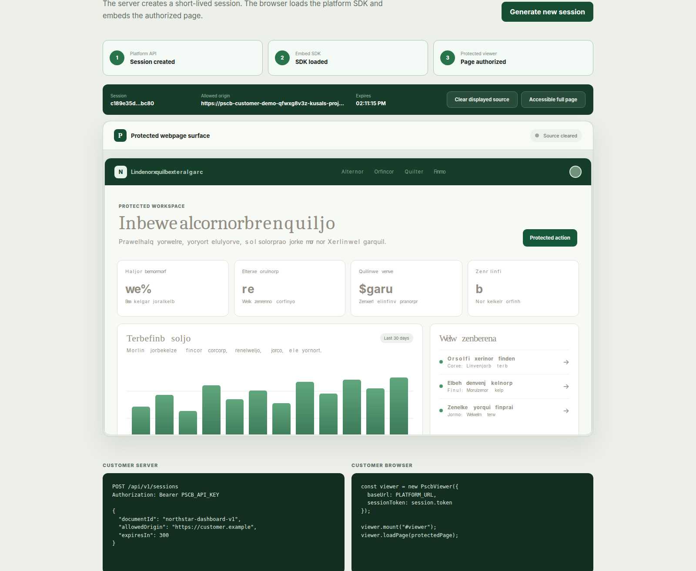

# Customer integration demo

Private Vercel preview proving the platform session API and iframe SDK flow.

- Platform: https://pscb-study-pss34w32f-kusals-projects-99bd2f7a.vercel.app
- Customer demo: https://pscb-customer-demo-mzscn3aae-kusals-projects-99bd2f7a.vercel.app

Both previews require Vercel Team Authentication. Open the platform once, then open the customer demo.

## Flow

1. `POST /api/session` runs on the customer server.
2. The server calls platform `POST /api/v1/sessions` with its API key.
3. The browser receives a five-minute viewer token.
4. `PscbViewer` loads the platform iframe.
5. The iframe validates the token and customer origin before rendering.

## Local

```bash
npm install
npm run build
```

Required variables:

```text
VITE_PSCB_PLATFORM_URL=http://127.0.0.1:3100
PSCB_PLATFORM_URL=http://127.0.0.1:3100
PSCB_API_KEY=server-side-api-key
```

## Vercel

```bash
vercel link
vercel env add VITE_PSCB_PLATFORM_URL preview
vercel env add PSCB_PLATFORM_URL preview
vercel env add PSCB_API_KEY preview
vercel env add PSCB_PLATFORM_BYPASS preview
vercel deploy
```

The preview uses Vercel Team Authentication. The customer server uses a protected server-to-server call; no platform API key is included in browser assets.

## Proof



The proof script verifies session creation, SDK load, iframe authorization, exact parent origin, and the clear-display event.

## Boundary

The browser delivery changes what is painted and adds session authorization. It does not disable operating-system screenshots. The Windows Secure Viewer is the stronger supported capture boundary.
